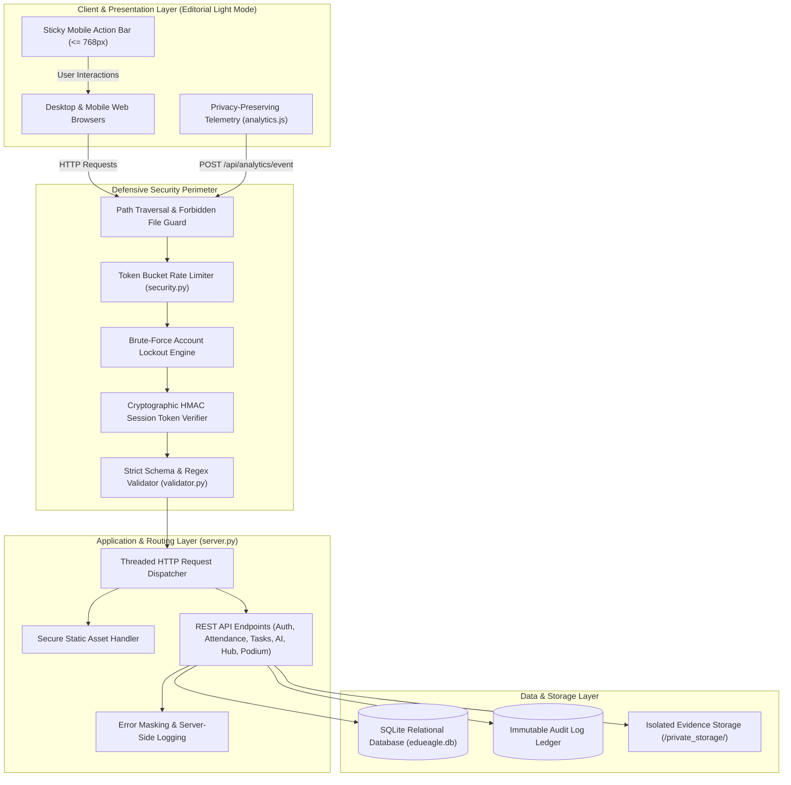
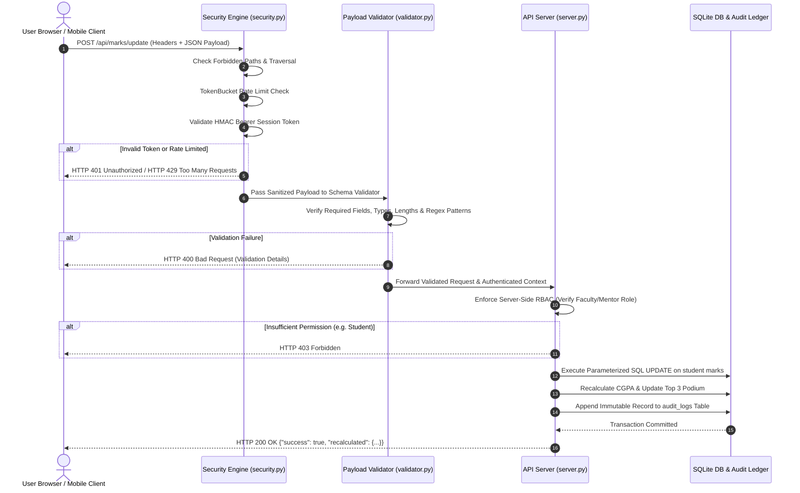

# EduEagle Architecture & System Design Specification

This document provides a comprehensive technical reference for the EduEagle Academic Workspace & Mentorship Companion platform. It details the layered architecture, component responsibilities, request lifecycle, data persistence models, role-based access controls (RBAC), security boundaries, and ethical governance safeguards under the Indian University Framework (NEP 2020 & DPDP Act 2023).

---

## 1. System Overview & Core Objectives

EduEagle is a human-crafted academic advisory, coursework hub, and student mentorship platform designed for higher education institutions. The platform moves beyond punitive surveillance to transparent, explainable, and accountable student support, learning enrichment, and holistic parent collaboration.

### Core Architectural Pillars
* **Visual Identity & Human-Crafted UX**: Crisp, warm Light Mode / Editorial White canvas (`#FAF9F6`), elevated white cards (`#FFFFFF`), Soft Sand containers (`#F3F1ED`), Deep Forest Emerald (`#0F5338`, `#15803D`) and Warm Terracotta (`#D95D39`) brand accents, with a strict zero-blue design rule and custom geometric soaring eagle squircle logo.
* **Strict Role-Based Access Control (RBAC)**: Clear demarcation between Faculty/Mentor (administrative, marks editing, task creation, manual AI scans, digest dispatch) and Student (read-only marks/attendance, interactive submissions up to 80 MB, PYQ archive, AI note summarizer, parent digest preview).
* **Smart Attendance & 3-Tier Risk Engine**: Automated threshold monitoring triggering mentor alerts whenever attendance drops below 75%, categorized into Low Risk (60-74.9% Amber), Medium Risk (50-59.9% Deep Orange), and High Risk (<50% Crimson Red).
* **Automated Mentor Pulse & Weekly Review**: Alternate-day student status feed (Mon, Wed, Fri) automatically pausing on institutional off-days/Sundays, paired with a mentor-customizable weekly review digest locked to a once-per-week cadence.
* **Bi-Weekly Parent Transparency Portal**: 14-day holistic 360-degree snapshot encompassing academic velocity, attendance trajectories, assignment milestones, and rich extracurricular records (clubs, sports, hackathons, leadership).
* **Task Studio with Manual AI Integrity Verification**: Drag-and-drop dropzone supporting up to 80 MB uploads with strict type enforcement (Projects allow Video/Doc/Photo; Assignments block Video and accept Doc/Photo only). AI verification is strictly teacher-initiated on-demand with Human vs. AI vs. Copy probability breakdowns.
* **Academic Resource Hub & Question-Driven AI Summarizer**: Subject-wise syllabus, lecture notes, and Previous Year Questions (PYQs 2023-2025) with an interactive query-driven AI assistant answering specific student prompts from note contents.
* **Academic Excellence Podium & Live Marks Ledger**: Top 3 scholarship/internship/grant podium dynamically recalculating ranks in real-time as faculty update continuous evaluation marks.
* **Defense-in-Depth Security**: Token bucket rate limiter with burst tolerance and smooth refill, cryptographic HMAC session tokens, strict schema validation, path traversal defense, and error sanitization.

---

## 2. High-Level System Architecture

---

## 3. Layered Architectural Decomposition

### 3.1 Presentation Layer (Frontend & Mobile UX)
* **Single-Page Application Shell**: [`static/index.html`](file:///d:/Programming/AI%20Aces/static/index.html) hosts modular interactive views:
  1. *Academic Excellence Podium & Marks Ledger*: Top 3 scholarship podium (Gold, Silver, Bronze) with unlocked rewards and editable marks ledger.
  2. *Smart Attendance Tracker*: 3-tier risk badges, subject-wise breakdown, and automated mentor alert dispatch.
  3. *Task Studio & Dropzone*: 80 MB file submission dropzone with Project vs. Assignment rules and teacher-only manual AI originality scan.
  4. *Academic Resource Hub*: Subject-organized notes, PYQ repository (2023-2025), and Question-Driven AI Note Summarizer.
  5. *Mentor Pulse & Weekly Review Scheduler*: Alternate-day sync feed, Sunday off-day pause indicator, and weekly digest day selector.
  6. *Parent Transparency Portal*: Bi-weekly 360-degree digest with extracurricular records and WhatsApp/Email dispatch preview.
  7. *Student Fee Ledger & Online Settlement Desk*: Itemized fee component breakdown (Tuition, Lab/Tech, Exam, Library, Amenities), online payment gateway integration, and downloadable bursar receipts.
  8. *Institutional Fee Management Desk*: Cohort billing intelligence (invoiced, collected, overdue, clearance rate %), filterable student accounts ledger, offline payment recording, and reminder dispatch.
  9. *Student 360 & Complete Work Portfolio Inspection*: Institutional full authority to inspect any student scholar's submitted coursework, files, marks, attendance, and fee history.
  10. *Cohort Analytics & Institutional Governance Desk*: High-level risk distribution, department indices, and DPDP Act compliance safeguards.
* **Responsive Breakpoints**: Engineered in [`static/css/style.css`](file:///d:/Programming/AI%20Aces/static/css/style.css) across 1024px (laptops/tablets), 768px (tablets/phones), and 480px (compact mobile devices).
* **Mobile Enhancements**: Bottom sticky CTA bar (`#sticky-mobile-cta`) for fast navigation, touch-friendly touch targets, horizontal scroll table wrappers, and stacked KPI cards.
* **Static Institutional Pages**:
  * [`static/privacy.html`](file:///d:/Programming/AI%20Aces/static/privacy.html): DPDP Act 2023 compliance and student data rights.
  * [`static/terms.html`](file:///d:/Programming/AI%20Aces/static/terms.html): Non-punitive institutional mandates and NEP 2020 framework.
  * [`static/thank-you.html`](file:///d:/Programming/AI%20Aces/static/thank-you.html): Support beacon confirmation receipt with SLA timeline.
  * [`static/404.html`](file:///d:/Programming/AI%20Aces/static/404.html): Custom institutional error recovery page.

### 3.2 Security & Validation Layer
* **Path Traversal Defense**: [`security.py`](file:///d:/Programming/AI%20Aces/security.py) inspects all incoming URLs before routing. Requests attempting to access hidden files (`.env`), system sources (`server.py`), or encoded directory traversals (`..%2f`) are immediately terminated with HTTP 403.
* **Token Bucket Rate Limiting**:
  * Employs continuous token refill based on elapsed time with burst allowance.
  * Public Auth Routes (`/api/auth/*`): 10 requests per 60-second window.
  * General API Routes (`/api/*`): 120 requests per 60-second window.
  * Brute-Force Defense: 5 consecutive failed sign-in attempts lock the targeted identifier for 300 seconds.
* **Cryptographic Token Verifier**: Generates and verifies HMAC-SHA256 tokens (`edueagle-token-<uid>.<timestamp>.<hmac_signature>`). Rejects forged or tampered signatures immediately with HTTP 401.
* **Schema Validation Engine**: [`validator.py`](file:///d:/Programming/AI%20Aces/validator.py) checks every POST payload against strict field specifications, allowed types, regex patterns, length boundaries, and whitelist enums. Unrecognized or malformed keys result in HTTP 400.
* **Input Sanitization**: Multi-pass HTML and script tag stripping neutralizes XSS payloads (`<script>`, `onerror`, `<iframe>`, `javascript:`) before database writes.

### 3.3 Application & Routing Layer
* **Threaded HTTP Server**: [`server.py`](file:///d:/Programming/AI%20Aces/server.py) implements `ThreadedHTTPServer` using Python's `socketserver.ThreadingMixIn` and `http.server.BaseHTTPRequestHandler` with `daemon_threads = True`.
* **Dynamic Role Adaptation**: Server-side RBAC enforces role checks on every sensitive endpoint. When `auth_user["rol"] == "Student"`, all marks editing, AI checks, task creation, and administrative triggers return HTTP 403.
* **Error Sanitization**: Server catches unhandled exceptions, logs detailed stack traces internally with unique incident identifiers (`INC-XXXXXXXX`), and returns generic error responses to clients.

### 3.4 Data & Storage Layer
* **Relational Storage**: SQLite database ([`edueagle.db`](file:///d:/Programming/AI%20Aces/edueagle.db)) operating in WAL mode with enforced foreign keys (`PRAGMA foreign_keys = ON;`).
* **Connection Pooling**: Managed via `database.get_db()` with `sqlite3.Row` factory for dictionary-style data access.
* **Audit Ledger**: Dedicated `audit_logs` table permanently records all critical institutional actions (marks updates, AI scan triggers, parent dispatches, attendance alerts).
* **Sandboxed Artifact Vault**: Stored outside the web root at `private_storage/` with strict extension, MIME type, and magic byte validation (PDF, PNG, JPG, MP4). Direct execution is prevented.

---

## 4. End-to-End Request Lifecycle

---

## 5. Core Functional Modules Deep-Dive

### Module A: Smart Attendance Tracker & Risk Categorization
- **Threshold Rule**: Real-time evaluation of student attendance across all enrolled subjects. Attendance below 75% triggers an automated alert dispatch to the assigned mentor.
- **3-Tier Risk Hierarchy**:
  - *Low Risk (60% to 74.9%)*: Warm Amber badge (`#D97706`). Continuous monitoring.
  - *Medium Risk (50% to 59.9%)*: Deep Orange badge (`#EA580C`). Advisory warning triggered.
  - *High Risk (Below 50%)*: Crimson Red badge (`#DC2626`). Immediate mentor intervention mandated.

### Module B: Automated Mentor Sync & Weekly Review Scheduler
- **Alternate-Day Pulse Feed**: Delivers student status updates every alternate day (Mon, Wed, Fri), automatically skipping Sundays and institutional off-days.
- **Configurable Weekly Review**: Default review report generated every Friday. Mentors can select an alternate day of the week via a dropdown selector, strictly locked to a single weekly run.

### Module C: Bi-Weekly Parent Transparency Portal
- **Holistic 14-Day Snapshot**: Generates parent progress summaries covering academic scores, 30-day attendance velocity, assignment completion percentage, and extracurricular engagements (e.g. Robotics Club, Inter-College Hackathon, Volleyball Team).
- **Communication Channels**: Mentor-initiated preview modal with single-click dispatch via simulated WhatsApp and Email channels.

### Module D: Task Studio & Manual AI Integrity Check
- **Task Publishing**: Faculty can create tasks categorized as **Project** or **Assignment** with strict submission deadlines.
- **File Validation (80 MB Cap)**:
  - *Project*: Accepts Video (`.mp4`, `.mov`), Documents (`.pdf`, `.docx`), and Photos (`.jpg`, `.png`).
  - *Assignment*: Strictly rejects video files; accepts Documents (`.pdf`, `.docx`) and Photos (`.jpg`, `.png`) only.
- **Manual AI Originality Scan**:
  - AI check is **never executed automatically** upon upload.
  - Teachers trigger the scan on-demand via **"Run AI & Copy Verification"**.
  - Scan outputs a granular tripartite breakdown: *Human-Written %*, *AI-Generated %*, and *Copied/Plagiarized %* with highlighted text passages and mentor notification capabilities.

### Module E: Academic Resource Hub & Question-Driven AI Summarizer
- **Organized Knowledge Base**: Curated subject repositories featuring course syllabus, lecture slides, and Previous Year Questions (PYQ archive from 2023 to 2025).
- **Interactive AI Assistant**: Students or teachers can submit natural-language prompts (e.g., *"Summarize key derivations from Unit 2 for a 10-mark question"*). The engine processes the note contents and generates tailored, structured answers.

### Module F: Academic Excellence Podium & Editable Marks Ledger
- **Dynamic Top 3 Podium**: Recognizes 1st Rank (Gold Medal, Merit Scholarship), 2nd Rank (Silver Medal, Priority Internship), and 3rd Rank (Bronze Medal, Annual Book Grant).
- **Editable Ledger**: Faculty can edit continuous evaluation marks directly in the UI. Totals, percentages, and podium rankings recalculate instantly. Students have strict read-only access (all input fields are stripped from DOM and blocked server-side).

---

## 6. Security Architecture & Threat Model

| Security Domain | Threat Vector | Architectural Countermeasure |
|:---|:---|:---|
| **Path Traversal & Secrets** | Probing for `/.env`, `/.git`, or source code files | Centralized `is_path_forbidden()` filter intercepts requests before path routing, terminating with HTTP 403. |
| **Authentication & Sessions** | Token spoofing, replay, or client identity manipulation | Server-side cryptographic HMAC-SHA256 signature verification. Token payload contains authoritative User ID and Role. Frontend user claims are never trusted. |
| **Data Isolation (DPDP/FERPA)** | Student tampering with request parameters to view other students' records | Strict server-side user data isolation. When `auth_user["rol"] == "Student"`, all queries are bounded to `WHERE student_id = auth_user["sid"]`. Direct ID queries for other students return HTTP 403. |
| **Authorization (RBAC)** | Privilege escalation (e.g. students editing marks or triggering AI scans) | Declarative permission matrix in [`security.py`](file:///d:/Programming/AI%20Aces/security.py) checked server-side via `has_permission(role, action)`. Unauthorized calls return HTTP 403. |
| **Brute-Force & Credential Stuffing** | Rapid automated password or OTP guessing | Token bucket rate limiter plus identifier-level lockout (5 failed attempts locks for 300 seconds). |
| **SQL Injection** | Malicious characters in query strings or JSON fields | All database queries use parameterized SQL placeholders (`?`). String concatenation is strictly prohibited. Path parameters are verified by compiled regex before query construction. |
| **Stored XSS** | Injected script tags in support beacon messages or advisory notes | Multi-stage regex sanitization strips script elements, event attributes (`onload`, `onerror`), and `javascript:` URIs prior to insertion. |
| **Malicious File Uploads** | Web shells or executable scripts disguised as homework artifacts | Validated file extensions (`.pdf`, `.png`, `.jpg`, `.mp4`), MIME type verification, file size limits (80 MB max for tasks), magic byte header inspection, and isolated storage outside the web root (`private_storage/`). |
| **Information Leakage** | Database stack traces or absolute file paths displayed to end users | Production error sanitization masks raw internal exceptions behind unique incident IDs (`INC-XXXXXXXX`), logging full stack traces server-side only. |
| **Browser Security Headers** | Clickjacking, MIME-type sniffing, cross-origin data theft | Strict security headers dispatched with every response: `Content-Security-Policy`, `X-Content-Type-Options: nosniff`, `X-Frame-Options: DENY`, `Cross-Origin-Opener-Policy: same-origin`, `Permissions-Policy`. |

---

## 7. Complete API Endpoint Specification

### Public & Authentication Endpoints
| Method | Endpoint | Description | Rate Limit |
|:---|:---|:---|:---|
| `POST` | `/api/auth/otp/request` | Requests simulation OTP for 10-digit mobile number | 10 req/min |
| `POST` | `/api/auth/login` | Authenticates via Phone+OTP, Google SSO, GitHub, or Role Switch | 10 req/min |
| `GET` | `/api/auth/me` | Fetches authenticated user profile & linked student record | 120 req/min |
| `POST` | `/api/analytics/event` | Ingests privacy-preserving client telemetry | 120 req/min |

### Academic Hub, Podium & Marks Endpoints
| Method | Endpoint | Required Permission | Description |
|:---|:---|:---|:---|
| `GET` | `/api/podium-and-marks` | Authenticated (Student, Faculty, Mentor) | Fetches Top 3 podium rankings and marks ledger |
| `POST` | `/api/marks/update` | `MARKS_EDIT` (Faculty, Mentor) | Updates student marks with live recalculation and podium re-ranking |
| `GET` | `/api/academic-hub/resources` | Authenticated (Student, Faculty, Mentor) | Fetches semester notes, syllabus, and PYQ archive |
| `POST` | `/api/academic-hub/summarize` | Authenticated (Student, Faculty, Mentor) | Question-driven AI note summarization |

### Attendance & Mentor Workflow Endpoints
| Method | Endpoint | Required Permission | Description |
|:---|:---|:---|:---|
| `GET` | `/api/attendance` | Authenticated (Student, Faculty, Mentor) | Fetches cohort attendance and risk tier breakdown |
| `POST` | `/api/attendance/alert` | `ATTENDANCE_ALERT` (Faculty, Mentor) | Dispatches attendance warning alert to mentor |
| `GET` | `/api/mentor/pulse` | `MENTOR_PULSE_VIEW` (Mentor, Faculty) | Fetches alternate-day pulse feed with off-day status |
| `GET` | `/api/mentor/review-schedule` | `MENTOR_PULSE_VIEW` (Mentor, Faculty) | Gets current weekly review digest configuration |
| `POST` | `/api/mentor/review-schedule` | `MENTOR_SCHEDULE_EDIT` (Mentor, Faculty) | Updates weekly review digest day of the week |

### Task Studio & AI Verification Endpoints
| Method | Endpoint | Required Permission | Description |
|:---|:---|:---|:---|
| `GET` | `/api/tasks` | Authenticated (Student, Faculty, Mentor) | Retrieves active assignments and project tasks |
| `POST` | `/api/tasks/create` | `TASK_CREATE` (Faculty, Mentor) | Publishes new Project or Assignment with deadline |
| `POST` | `/api/tasks/{task_id}/submit` | `TASK_SUBMIT` (Student, Faculty) | Submits file up to 80 MB (enforces Project vs. Assignment rules) |
| `POST` | `/api/submissions/{sub_id}/ai-check` | `AI_CHECK_RUN` (Faculty, Mentor only) | Manually runs AI originality and copy detection |
| `POST` | `/api/submissions/{sub_id}/notify-flag` | `AI_FLAG_NOTIFY` (Faculty, Mentor) | Notifies mentor and student of originality flag |

### Parent Transparency Portal Endpoints
| Method | Endpoint | Required Permission | Description |
|:---|:---|:---|:---|
| `GET` | `/api/parent-digest/{student_id}` | Authenticated (Student own record, Faculty, Mentor) | Generates bi-weekly 360-degree parent digest |
| `POST` | `/api/parent-digest/{student_id}/send` | `PARENT_DIGEST_SEND` (Mentor, Faculty) | Dispatches bi-weekly digest via WhatsApp/Email |

### Fee Management & Student Complete Work Inspection Endpoints
| Method | Endpoint | Required Permission | Description |
|:---|:---|:---|:---|
| `GET` | `/api/fees/my` | Authenticated (Student own profile) | Fetches personalized student fee ledger, itemized components, and verified transactions |
| `GET` | `/api/fees` | `FEE_VIEW_COHORT` (Faculty, Mentor, Bursar) | Cohort billing intelligence (invoiced, collected, overdue, clearance rate %, filterable accounts) |
| `GET` | `/api/fees/{student_id}` | Authenticated (Student own record, Staff) | Strict data isolation: students can only access their own fee ledger; staff can access any |
| `POST` | `/api/fees/{student_id}/pay` | Authenticated (Student own record, Staff) | Online payment gateway settlement (UPI, Net Banking, Card) with instant receipt generation |
| `POST` | `/api/fees/{student_id}/record-payment` | `FEE_MANAGE` (Institutional Staff, Bursar) | Records offline bank drafts, NEFT transfers, or counter deposits with audit receipt |
| `POST` | `/api/fees/{student_id}/remind` | `FEE_MANAGE` (Institutional Staff, Bursar) | Dispatches statutory fee reminder notices via WhatsApp and University Email |
| `GET` | `/api/students/{student_id}/complete-work` | `STUDENT_WORK_INSPECT` (Institutional Full Authority) | Complete coursework portfolio: all submitted files, sizes, timestamps, marks, AI scans, and fee status |

---

## 8. Automated Testing & Verification Suite

The platform maintains four dedicated automated test suites verifying all functional, security, responsive UX, redesign, and institutional role isolation requirements:

1. **Defensive Security & Untrusted User Suite** ([`test_untrusted_user.py`](file:///d:/Programming/AI%20Aces/test_untrusted_user.py)):
   * **35 Tests (100% Pass)**: Validates path traversal filtering, HMAC token issuance and tamper rejection, server-side RBAC enforcement, student data isolation, XSS input neutralization, SQL injection defense, brute-force lockout, security headers, and secure artifact handling.
2. **Frontend, SEO & Metadata Suite** ([`test_frontend_seo.py`](file:///d:/Programming/AI%20Aces/test_frontend_seo.py)):
   * **40 Tests (100% Pass)**: Validates custom 404 routing, above-the-fold CTA accessibility, unique meta titles and descriptions, Open Graph PNG/SVG assets, complete multi-platform favicon suite, robots.txt, sitemap.xml, and 100% image alt text coverage.
3. **Mobile UX & Compliance Suite** ([`test_mobile_ux.py`](file:///d:/Programming/AI%20Aces/test_mobile_ux.py)):
   * **14 Tests (100% Pass)**: Validates responsive breakpoints (1024px, 768px, 480px), sticky mobile action bar, loading progress bars and button spinners, form error highlighting, thank-you page confirmation receipts, privacy and terms legal pages, cookie consent banner, analytics telemetry, real contact address coordinates, and strict anti-vibe-coding redlines.
4. **Comprehensive 6-Core Module & RBAC Suite** ([`test_new_modules.py`](file:///d:/Programming/AI%20Aces/test_new_modules.py)):
   * **57 Tests (100% Pass)**: Validates Academic Excellence Podium & live recalculation, Student read-only mark controls, Smart Attendance 3-tier categorization (<75% alerts), Mentor Pulse alternate-day sync with Sunday pause, configurable weekly review day, Bi-Weekly Parent Portal with extracurriculars, Task Studio 80 MB drag-and-drop validation (blocking videos for assignments, allowing for projects), Teacher-Only Manual AI scan with probability breakdowns, Question-Driven AI Note Summarizer, Token Bucket continuous rate limiting, Student Fee Ledger & strict data isolation (403 on other students), Institutional Cohort Billing Desk & offline payment recording, Statutory fee reminder dispatch, Student online payment settlement with automatic balance deduction, and Institutional Full Authority complete student coursework inspection.

**Total Automated Coverage: 146 / 146 Passing Tests (0 Failures)**.

